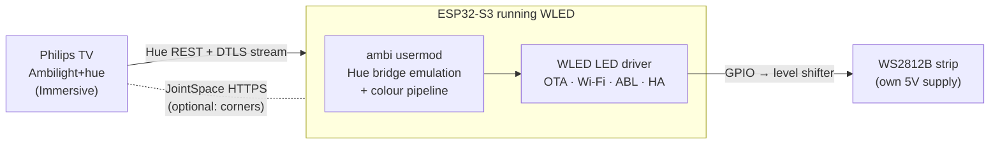
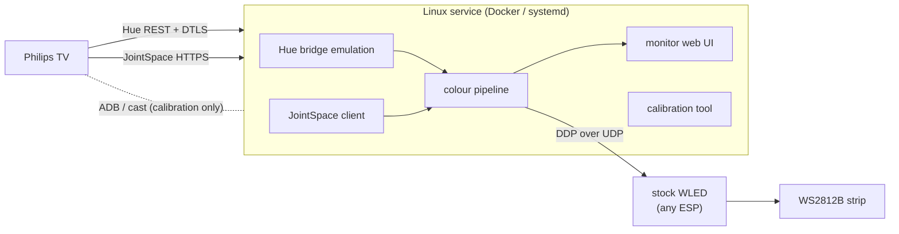
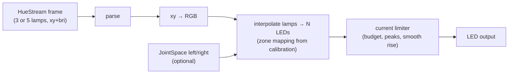

# Architecture — Bottom Ambilight for Philips TVs

A DIY 4th (bottom) Ambilight side for Philips Ambilight TVs. The TV believes it
is talking to a Philips Hue bridge, streams the colours for "bottom" lamps over
Hue Entertainment (DTLS), and this project turns them into a smooth, current-
limited WS2812B strip under the TV — optionally blended at the corners with the
TV's own left/right Ambilight, read over the TV's local JointSpace API.

Status: protocol, colour pipeline and monitor are working on Linux against a
real 65OLED707/12. The ESP32 firmware is not written yet. See the roadmap.

## Two ways to run it

The same portable C++ core runs in both. Users pick what fits their hardware.

### Mode A — Standalone (ESP32 only, the end goal)



No server needed. WLED provides Wi-Fi setup, OTA updates, the LED driver, a
brightness limiter as a safety net, a web UI and Home Assistant integration.
The usermod adds the Hue bridge and our colour pipeline.

### Mode B — Linux companion + any WLED device



Works with **unmodified WLED** on any ESP (even small ones), so it is the
easiest way in for other people. It is also where everything goes that does not
fit, or does not belong, on a microcontroller.

### Hybrid (recommended for power users)

Mode A does the real-time work on the ESP. The Linux companion is used only
occasionally, for calibration, monitoring and management. It pushes its results
(zone mapping, colour correction, current settings) to the ESP through WLED's
JSON API or the usermod's settings.

## What runs where

| Feature | ESP (Mode A) | Linux (Mode B) | Notes |
|---|---|---|---|
| Hue bridge emulation (pairing, groups, SSDP/mDNS) | ✅ | ✅ | TV only talks to port 80 — on the ESP it must share WLED's web server |
| Entertainment stream (DTLS-PSK) | ✅ | ✅ | mbedTLS on both |
| Colour pipeline (xy→RGB, interpolation, current limit) | ✅ | ✅ | same source, `core/` |
| Peak-preserving current limit + smooth rise | ✅ | ✅ | done in the Linux bridge since v0.13 (`peak_emphasis`, `rise_ms`); ESP port pending |
| LED output | direct | DDP → WLED | |
| JointSpace (TV's own sides, corner blending) | ⚠️ if RAM allows | ✅ | ESP32-S3 without PSRAM is tight with DTLS + TLS together |
| Monitor dashboard | basic (WLED UI) | full (4 views, live) | |
| Calibration (test patterns, zone mapping, colour match) | ❌ | ✅ | needs ADB/cast + compute; result is pushed to the ESP |
| ADB to the TV | ❌ | ✅ | kept off the ESP on purpose (an authorised ADB key = full shell on the TV) |
| Home Assistant | via WLED | via WLED | |
| Updates | WLED OTA | package/container | |

## Data path (both modes)



Every parsed frame updates freshness/fps, even when the colours have not
changed. Colour de-duplication only skips re-rendering. Getting that wrong was
the "stale bottom" bug in v5.

## Repository layout (target)

```
core/            portable C++17: huestream, colour pipeline, Hue protocol logic + unit tests
linux/           companion: bridge, DTLS server, JointSpace client, monitor, terminal UI, DDP output
wled-usermod/    WLED usermod using core/
tools/           calibrate.py, mock TV, REST diff vs. reference, stream test, dashboard renderer
docs/            ARCHITECTURE.md, HARDWARE.md, SETUP.md, CALIBRATION.md, TROUBLESHOOTING.md
hardware/        wiring diagram, BOM, 3D-printable case
```

The current `ambi-bridge-cpp` tree maps onto `core/` + `linux/` + `tools/`.

## Reference hardware

| Part | Used here | Notes |
|---|---|---|
| Controller | M5Stack AtomS3 Lite (ESP32-S3, 8 MB flash, no PSRAM) | any ESP32 that WLED supports for Mode B |
| Level shifter | Adafruit Pixel Shifter #6066 | V = 3V3, DAT ← GPIO5, D5 → strip DIN; already has 100 Ω on the outputs. **No power passes through it.** |
| Strip | WS2812B ECO, 30 LED/m, 43 LEDs (65") | vendor spec 9 W/m → 60 mA/LED full white; measure your own |
| Strip power | separate 5 V USB, 900 mA | common GND with the ESP; never join the two +5V rails |

Wiring: ESP 3V3/GND/GPIO5 → shifter V/G/DAT. Shifter D5 → strip DIN, shifter
G → strip GND. Strip +5V/GND straight from its own supply. The current
limit is mandatory: 43 LEDs at full white is ~2.6 A.

## Before publishing — checklist

- **Per-device identity.** `bridge_identity.hpp` hardcodes one MAC/bridge id.
  Generate a random one per install on first run (Philips OUI `00:17:88`),
  persist it, and allow an override. Otherwise two installs on one network
  collide.
- **No secrets in the repo.** Pairing usernames/client keys, JointSpace
  credentials and ADB keys live only in the state dir (`/var/lib/...` or ESP
  NVS). Add `.gitignore` entries, and a check in CI.
- **Licences.** WLED is EUPL-1.2, so the usermod ships as part of a WLED build.
  Choose a licence for this project that is compatible with it. Protocol
  knowledge came from diyHue (Apache-2.0), relume-tv (MIT) and
  ha-hue-entertainment (MIT): credit them in the README.
- **Names.** "Philips", "Hue" and "Ambilight" are trademarks. Use them only
  descriptively ("for Philips Ambilight TVs"), not as the project name or logo.
- **Compatibility statement.** Tested on 65OLED707/12 only. Other models may
  differ (zone counts, JointSpace version, Immersive availability).
- **Safety notes.** Separate strip supply, current limiter on, no power through
  the level shifter.

## Roadmap

1. **Fix**: TV greys out "Immersive experience" after a restart of the TV or the bridge (open issue, see HANDOFF.md).
2. **WLED analysis** (done 2026-10-31, `WLED-ANALYSIS.md`): usermod API, port-80 sharing, Espalexa's Hue emulation conflict, mDNS, DTLS + RAM on ESP32-S3.
3. **Pipeline** (done, v0.13–v0.15): peak-preserving current limit, smooth rise, settings in the monitor UI (`ma_per_led_full_white` default 60 until measured).
4. **Mode B output** (code done, v0.11; not yet tried on real hardware): DDP to stock WLED. First real light under the TV.
5. **Calibration tool (Linux)**: generated test patterns via ADB/cast; zone mapping, colour match to the factory sides; read Ambilight brightness, saturation and wall colour from JointSpace; optional camera.
6. **Mode A**: WLED usermod.
7. **Publish**: repo restructure, docs, BOM, wiring, case, licence, per-device identity.
